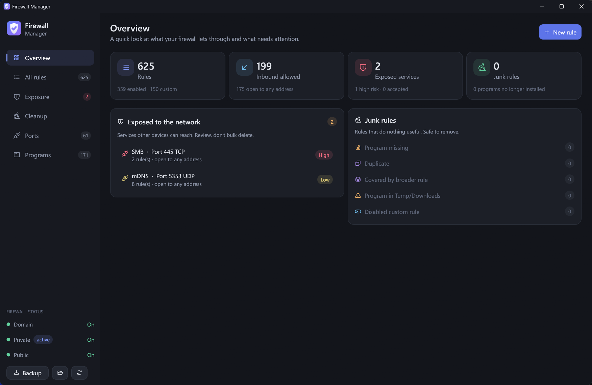
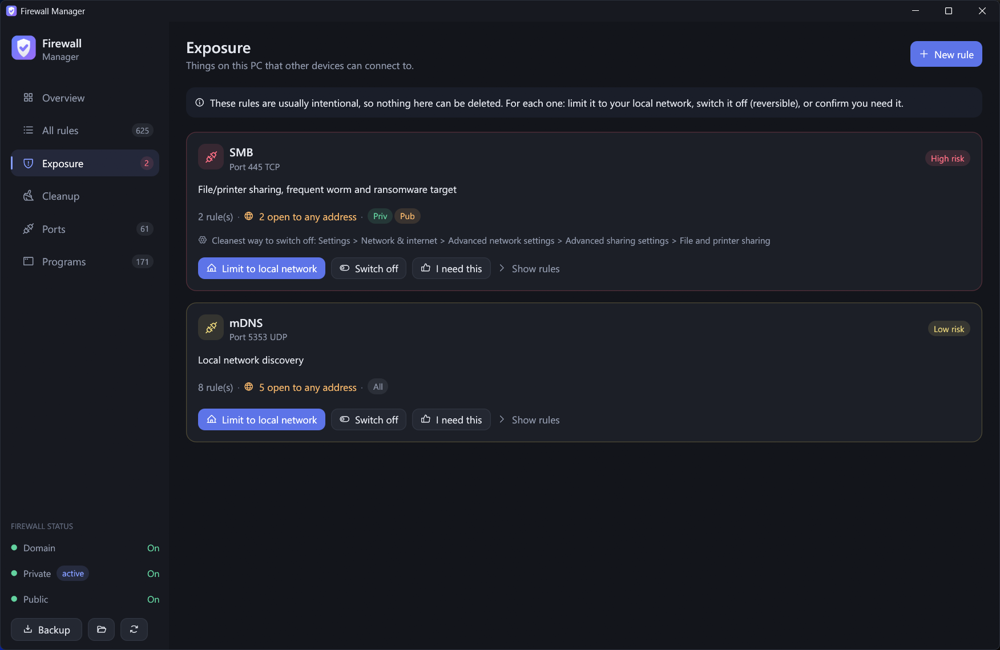
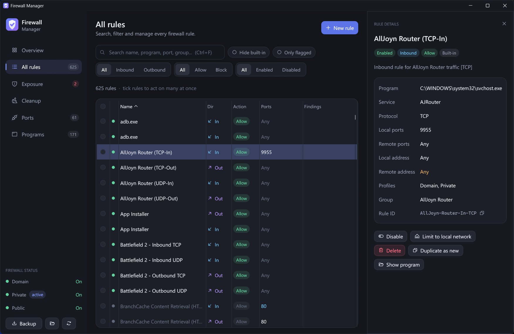

# Firewall Manager

A clean, dark-themed overview of your Windows Firewall rules, made for tidying up years of
"Allow access?" prompts and finding the rules that actually matter.

The built-in *Windows Defender Firewall with Advanced Security* console shows hundreds of rules in one
flat list. Firewall Manager groups them, explains them and points out what's junk and what's exposed.



## Features

- **Overview.** Rule counts, firewall status per network profile (Domain / Private / Public), what's
  exposed to the network and how much junk there is, all on one screen.
- **Exposure.** Every service other devices can reach (SMB, RDP, databases, WinRM, NetBIOS, ...),
  grouped by service and rated by risk. Each one can be:
  - **Limited to your local network** (remote address set to `LocalSubnet`)
  - **Switched off** (disabled, reversible)
  - **Accepted** with "I need this", so it stops being flagged
  
  Where Windows has a proper switch for the feature (e.g. *File and printer sharing*), the card tells
  you where to find it.
- **Cleanup.** Rules that do nothing useful and are safe to remove:
  - **Program missing.** The program, or the Store app package, is gone (uninstalled, moved, old version
    folder).
  - **Duplicate.** Identical in every condition to another rule. One copy is always kept.
  - **Covered by broader rule.** Another enabled rule already matches all of its traffic.
  - **Program in Temp/Downloads.** Usually installers or one-off tools that were allowed once.
  - **Disabled custom rule.** Switched off and doing nothing.
- **All rules.** Instant search across name, program, port, group and rule ID. Filter by direction,
  action, state, built-in or flagged. Sortable columns, profile badges, sensitive ports
  highlighted by risk, and bulk enable / disable / delete.
- **Ports.** Every port referenced by any rule, how many rules cover it and whether it's open
  inbound.
- **Programs.** Rules grouped per program, with programs that no longer exist listed first.
- **New rule / Duplicate as new.** A simple form with a program picker and a warning when you're
  about to open a sensitive port.





## Safety

The app is built so you can't easily shoot yourself in the foot:

- **Automatic backup.** Before the first change in each session, the whole firewall policy is exported
  to `%LOCALAPPDATA%\FirewallManager\backups\firewall-<date>.wfw`. Use the **Backup** button any time
  for an extra one.
- **Exposed services can't be deleted** from the Exposure page. You limit, disable or accept them instead.
- **Built-in Windows rules** need an extra "I understand" tick before they can be deleted, and the
  dialog offers **Disable instead** as the default. Windows' own switches (network discovery, file
  sharing, ...) rely on those rules.
- **Group Policy rules** are shown but read-only.
- **Exact targeting.** Rules are changed by their unique rule ID, so the right rule is hit even when
  several share a display name.

### Restoring a backup

From an elevated prompt:

```powershell
netsh advfirewall import "C:\Users\<you>\AppData\Local\FirewallManager\backups\firewall-<date>.wfw"
```

> **Note:** importing replaces the *entire* firewall policy with the backup.

## Building

Requires Windows 10/11 and a Rust toolchain (stable, 1.88+).

```powershell
cargo build --release
```

The exe lands in `target\release\FirewallManager.exe`. It embeds its icon and a manifest that
requests administrator rights, so Windows shows a UAC prompt on launch.

> `cargo run` from a non-elevated terminal fails with error 740 because of the manifest. Run it from
> an elevated terminal, or start the built exe directly.

### Tests

```powershell
cargo test --lib
# Optional: analyse the real firewall rules on this machine (read-only)
cargo test --lib load_real_rules -- --ignored --nocapture
```

Tests run without elevation, because only the app binary carries the admin manifest.

## How it works

| What | How |
|---|---|
| Reading rules | Straight from the firewall's registry store (`SharedAccess\Parameters\FirewallPolicy\FirewallRules`, plus the Group Policy store). Fast, and exposes each rule's unique ID. Resource names like `@FirewallAPI.dll,-28502` are resolved with `SHLoadIndirectString`. |
| Delete / enable / disable / limit | The `NetSecurity` PowerShell module (`Remove-NetFirewallRule`, `Set-NetFirewallRule`) addressed by rule ID, batched into one hidden PowerShell process. |
| Creating rules | The `INetFwPolicy2` / `INetFwRule` COM API. |
| Store app detection | Installed package families are read from the AppModel package repository, to spot rules for uninstalled apps. |
| UI | [egui](https://github.com/emilk/egui) / eframe with a custom soft dark theme, Segoe UI and [Phosphor](https://phosphoricons.com/) icons. The native title bar is tinted to match the app via DWM. |

### Project layout

```
build.rs          icon (.ico) generation + resources + admin manifest
src/main.rs       window setup
src/app.rs        all UI
src/firewall.rs   reading / changing rules, backups
src/analysis.rs   findings: missing, duplicate, covered, exposure grouping, ...
src/ports.rs      well-known ports, their risk and where Windows can switch them off
src/theme.rs      colours, fonts, style, title bar
src/icon.rs       procedurally drawn app icon (shared by build.rs and the app)
```

User data is stored in `%LOCALAPPDATA%\FirewallManager\`: `backups\`, plus `reviewed.txt` with the IDs of
rules you marked as reviewed or accepted.

## Keyboard shortcuts

| Key | Action |
|---|---|
| `Ctrl+F` | Search rules |
| `Ctrl+N` | New rule |
| `F5` | Reload |
| `Del` | Delete selected rules (with confirmation) |
| `Esc` | Close details / clear selection |
